<div align="center">

# 🌴 Shubham Bramhane | Grand Theft Code VI — Leonida Edition
### Senior Full-Stack Architect & AI-Augmented Engineer
**5+ Years Experience • Laravel Ecosystem Specialist • AI Agentic Orchestration • MBA in Finance & IT**

[](https://my-portfolio-shubham-bramhanes-projects.vercel.app)
[](https://my-portfolio-shubham-bramhanes-projects.vercel.app/shubham_bramhane_resume.pdf)
[](https://nextjs.org/)
[](https://www.typescriptlang.org/)
[](https://laravel.com/)

<p align="center">
  <a href="#-design-philosophy-gta-vi--vice-city-sunset-3d-github-banner-edition">GTA VI 3D Theme</a> •
  <a href="#-featured-leonida-missions-case-studies">Missions</a> •
  <a href="#-tech-arsenal">Tech Arsenal</a> •
  <a href="#-engineering-documentation">Docs &amp; PDF</a> •
  <a href="#-local-setup--development">Setup</a> •
  <a href="#-contact--vice-comms">Contact</a>
</p>

---

</div>

## 📌 Executive Overview

Personal digital portfolio and technical architecture showcase for **Shubham Bramhane** — Senior Full-Stack Engineer with over 5 years of production experience across enterprise backend systems, pan-India healthcare diagnostic portals, and high-concurrency database optimizations.

Combining deep backend craftsmanship (**Laravel 11, PHP 8.3, Redis caching, MySQL/PostgreSQL indexing**) with **Agentic AI engineering workflows** (**Google Antigravity IDE, GitHub Copilot, Claude 3.7, GPT-4**) to achieve **3.5x sprint velocity** with zero regression. Currently pursuing an **MBA in Finance & IT**, bridging high-performance software architecture with business ROI and IT governance.

---

## 🌴 Design Philosophy: "GTA VI — Vice City Sunset 3D (GitHub Banner Edition)"

Crafted to match the signature **GitHub Profile Banner** aesthetic combined with **Grand Theft Auto VI (Vice City / Leonida Sunset)** art direction and interactive **3D depth**:

- **Custom Widescreen GTA VI Vice Sunset Artwork (`public/gta6-vice-hero.jpg`)**: Deep Midnight Navy (`#090d1f`) on the left transitioning seamlessly into glowing Flamingo Pink (`#ff4fa3`) & Coral (`#ff7b54`) sunset clouds, Golden Sun (`#ffd166`), modern lit Miami skyscrapers, shimmering Turquoise Biscayne Bay reflections (`#22d3ee` / `#38bdf8`), and tropical palm silhouettes on the right.
- **Interactive 3D Multi-Plane Parallax & Canvas (`Vice3DCanvas.tsx`, `Tilt3DCard.tsx`)**:
  - Multi-layer mouse-parallax Hero stage with a live 60fps HTML5 3D receding ocean grid and depth-sorted floating sunset bokeh particles.
  - Pointer-tracking **3D Tilt Cards** (`perspective(1100px) rotateX/Y`) with dynamic cursor-following specular sunset/cyan glare and `translateZ` floating inner badges across all sections.
- **Sleek Geometric Typography**: Clean `Outfit` display headings (`SENIOR FULL-STACK ARCHITECT` cyan eyebrow + bold `Shubham Bramhane` title + 4 glowing action cards: `Explore Projects`, `Download Resume`, `LinkedIn Profile`, `Initiate Contact`), `Inter` body copy, `JetBrains Mono` terminal code, and `Yellowtail` Vice script accents.
- **6-Star GTA VI Wanted Meter & Biscayne Bay Mini-Map (`Navbar.tsx`, `GtaHud.tsx`)**: Floating midnight-navy glass dock with `SB VI` badge, live `1★ → 6★` scroll progression, collapsible bottom-left Biscayne Bay radar (`VI-01`–`VI-06`), and `"Mission Passed"` / `"Resume Acquired"` toast banners.

---

## ⚡ Leonida.net Vice Terminal VI

The hero section includes an interactive **Leonida.net // Vice Terminal VI** with 3 live tabs and one-click clipboard copy:

| Tab | File | Key Focus |
|---|---|---|
| **`Architecture.ts`** | `// LEONIDA.NET DOSSIER` | Laravel 11 architecture, Redis turbo cache (+30% throughput), relational schema & AI loadout |
| **`AI-Agentic-Engine.json`** | `GTA_VI_LEONIDA_OVERDRIVE` | Google Antigravity IDE orchestration, autonomous refactoring, synthetic tests, 3.5x sprint velocity |
| **`Leonida-Live.log`** | `Live Telemetry` | Active healthcare portal status (Oncquest & Lal PathLabs), Redis cluster health, MBA ROI layer |

---

## 🚀 Featured Leonida Missions (Case Studies)

1. **Oncquest Healthcare Diagnostic Ecosystem** (`Vice Med Center` & `Leonida HQ`) — [oncquestlabs.com](https://oncquestlabs.com) & [admin.oncquestlabs.com](https://admin.oncquestlabs.com/admin) (`Laravel, React.js, Vue.js, Redis, MySQL`) • **+30% Query Velocity Boost**.
2. **OncqFieldAssist** (`Leonida Keys`) — [oncqfieldassist.oncquestlabs.com](https://oncqfieldassist.oncquestlabs.com) (`Laravel, PHP, MySQL`) • Real-time phlebotomist tracking & home sample collection logistics.
3. **Big Basket TMS** (`Port Gellhorn`) — [bbtms.centumlearnpro.in](https://bbtms.centumlearnpro.in) (`Laravel, PHP, MySQL, REST APIs`) • Enterprise trainer allocation & certification analytics.
4. **Lal Path Labs Platform & SEO Engine** (`Ambrosia District`) — [lalpathlabs.com](https://www.lalpathlabs.com) (`Laravel, PHP, Dynamic SEO, MySQL`) • High-traffic diagnostics portals & organic reach engine.
5. **Magical Umbrella Python Automation** (`Grassrivers Labs`) — [magicalumbrella.com](https://magicalumbrella.com/) (`Python, MySQL, REST APIs`) • Automated data pipelines saving **10+ manual hours weekly**.

---

## 🛠️ Tech Arsenal

```mermaid
graph TD
    A[Shubham Bramhane - Senior Full-Stack Architect] --> B[Backend Architecture]
    A --> C[AI Agentic Engineering]
    A --> D[Frontend & GTA VI HUD]
    A --> E[DevOps, Security & Scale]

    B --> B1[PHP 8.3 & Laravel 11]
    B --> B2[Redis Cache Clusters +30% Speed]
    B --> B3[MySQL & PostgreSQL Indexing]
    B --> B4[RESTful APIs & Swagger Spec]
    B --> B5[Python Automation Pipelines]

    C --> C1[Google Antigravity Agentic IDE]
    C --> C2[GitHub Copilot Pair-Programming]
    C --> C3[Claude 3.7 & GPT-4 Architecture]
    C --> C4[Autonomous Multi-File Refactoring]

    D --> D1[React.js & Next.js 16 SSR]
    D --> D2[Vue.js & Vuex State]
    D --> D3[TypeScript & Custom CSS3]
    D --> D4[Blade Full-Stack UI]

    E --> E1[Git & GitHub CI/CD]
    E --> E2[Linux & cPanel Deployments]
    E --> E3[Payment Gateways Razorpay/Stripe]
    E --> E4[CSRF & SQLi Defense]
```



---

## 📚 Engineering Documentation

Full project specifications and a shareable overview PDF are maintained under `docs/`:

- 📋 **[Product Requirements Document (`docs/prd.md`)](./docs/prd.md)** — Problem statement, personas, functional requirements, user flows, and success metrics.
- 🏗️ **[Technical Requirements Document (`docs/trd.md`)](./docs/trd.md)** — System architecture, tech stack, data schemas, `/api/contact` contract, and security constraints.
- 🗺️ **[Implementation Plan (`docs/implementation-plan.md`)](./docs/implementation-plan.md)** — Completed GTA VI milestones, component dependency map, and roadmap.
- 🧪 **[Testing Strategy (`docs/testing-strategy.md`)](./docs/testing-strategy.md)** — Build/type checks, manual & browser QA scenarios, and planned CI test suites.
- 🚀 **[Deployment Plan (`docs/deployment-plan.md`)](./docs/deployment-plan.md)** — Environment variables, Vercel release workflow, smoke tests, and rollback procedures.
- 📄 **[Shareable Portfolio Overview PDF (`docs/shubham-bramhane-portfolio-overview.pdf`)](./docs/shubham-bramhane-portfolio-overview.pdf)** — Clean two-page GTA VI Leonida summary of the product, features, architecture, and deployment highlights.

---

## 💻 Local Setup & Development

### Prerequisites
- Node.js `18.x` or `20.x+`
- npm (use `npm.cmd` on Windows PowerShell if script execution policy blocks `npm.ps1`)

### Quick Start
```bash
# Clone the repository
git clone https://github.com/shubham-bramhane/my-portfolio.git
cd my-portfolio

# Install dependencies
npm install

# Run local development server
npm run dev
```

Open [http://localhost:3000](http://localhost:3000) in your browser.

### Production Verification
```bash
# Type-check and build optimized production bundle
npx tsc --noEmit
npm run build
npm run start
```

---

## 📬 Contact & Vice Comms

- **Email**: [shubham.bramhane75@gmail.com](mailto:shubham.bramhane75@gmail.com)
- **Direct Phone**: [+91 8857916707](tel:+918857916707)
- **Location**: Chandrapur, Maharashtra - 442401, India
- **LinkedIn**: [linkedin.com/in/shubham1602](https://linkedin.com/in/shubham1602)
- **GitHub**: [github.com/shubham-bramhane](https://github.com/shubham-bramhane)
- **Live Deployment**: [my-portfolio-shubham-bramhanes-projects.vercel.app](https://my-portfolio-shubham-bramhanes-projects.vercel.app)

---

<div align="center">
  <sub>Engineered with Next.js 16, TypeScript 5, and Google Antigravity • Grand Theft Code VI (Leonida Edition) • © 2026 Shubham Bramhane.</sub>
</div>
