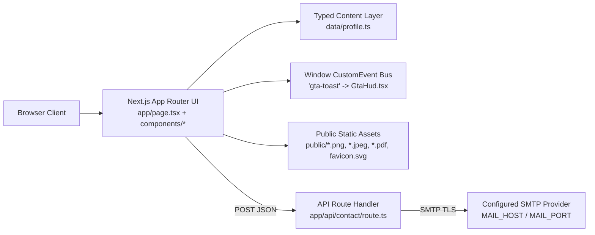

# Technical Requirements Document (TRD) — Shubham Bramhane Portfolio (GTA VI Leonida Edition)

## 1. System Architecture
The application is a single-repository **Next.js 16 (App Router)** full-stack web application deployed on Vercel. All portfolio content is statically bundled from a strongly typed TypeScript data module (`data/profile.ts`), while the contact form communicates with a server-side Route Handler (`app/api/contact/route.ts`) that dispatches transactional HTML emails over SMTP via Nodemailer.



## 2. Tech Stack
| Layer | Technology | Version / Notes |
|---|---|---|
| Framework | Next.js (App Router) | `^16.2.2` |
| UI Runtime | React & React DOM | `^19.2.4` |
| Language | TypeScript (`strict: true`) | `^5` |
| Styling | Vanilla CSS Design System (`app/globals.css`) | GTA VI Leonida Sunset Custom Properties, Grid/Flexbox, 6-segment stat bars, responsive breakpoints |
| Typography | `next/font/google` | `Anton`, `Barlow_Condensed`, `Inter`, `JetBrains_Mono`, `Yellowtail` |
| Image Optimization | `next/image` | Responsive sizes & priority loading on above-the-fold portrait |
| Backend Email | `nodemailer` | `^8.0.4` inside `app/api/contact/route.ts` |

## 3. Codebase Structure & Data Model
- `app/layout.tsx`: Self-hosts Google Fonts into CSS variables (`--font-outfit`, `--font-inter`, `--font-mono`, `--font-vice-script`) and configures GTA VI 3D SEO/OpenGraph metadata and `/favicon.svg`.
- `app/page.tsx`: Composes `Navbar`, `Hero`, `About`, `Skills`, `Projects`, `Experience`, `Contact`, `Footer`, and `GtaHud` inside `<main className="gta-world-root">`.
- `components/Tilt3DCard.tsx`: Reusable pointer-tracking 3D perspective tilt shell (`perspective(1100px) rotateX(...) rotateY(...)`) with dynamic cursor-following specular sunset/cyan glare and `transform-style: preserve-3d` inner depth layers.
- `components/Vice3DCanvas.tsx`: Lightweight 60fps HTML5 `<canvas>` rendering a 3D receding ocean perspective grid and depth-sorted floating Vice sunset bokeh particles reacting to mouse parallax.
- `app/globals.css`: Complete **"GTA VI Vice City Sunset 3D (GitHub Banner Edition)"** design system defining midnight-navy & Biscayne ocean tokens (`--bg-navy`, `--vi-pink`, `--vi-coral`, `--vi-peach`, `--vi-gold`, `--vi-cyan`, `--vi-aqua`, `--vi-mint`), 3D multi-plane Hero backdrop (`/gta6-vice-hero.jpg`), 4 GitHub-banner glowing action cards, 6-segment stat bars, Leonida postcard cards, HUD overlay, and breakpoints (`1120px`, `1024px`, `768px`, `400px`).
- `data/profile.ts`: Exports immutable portfolio datasets:
  - `profile`: Identity, contact info, metrics array (`value`, `label`, `sub`, `statPct`, `accent: 'aqua' | 'pink' | 'gold' | 'coral'`), social links, and `resumeUrl`.
  - `terminalTabs`: Array of `{ id, label, language, code }` for the interactive `LEONIDA.NET // VICE TERMINAL VI`.
  - `coreCompetencies`: Array of 4 core pillars `{ id, title, icon, badge, description }`.
  - `skills`: Array of 4 categorized skill groups with `{ name, tag, level }` items (`level` 0–100).
  - `projects`: Array of 7 projects `{ id, title, subtitle, postcardZone, description, tags, category, impact, github, live, image?, color, period }`.
  - `experience`: Array of 7 work and academic records `{ id, type: 'work' | 'education', title, organization, period, badge, description, highlights }`.
- `components/GtaHud.tsx`: Subscribes to passive `window` scroll events for Leonida Bay mini-map sector tracking (`VI-01`–`VI-06`) and `window` `gta-toast` custom events via `triggerGtaToast(title, subtitle, variant: 'sunset' | 'pink' | 'aqua')`.

## 4. API Route Contract
### `POST /api/contact`
- **Request Headers**: `Content-Type: application/json`
- **Request Body**:
  ```json
  {
    "name": "string (required)",
    "email": "string (required)",
    "subject": "string (optional)",
    "message": "string (required)"
  }
  ```
- **Responses**:
  - `200 OK`: `{ "success": true }` after Nodemailer dispatches the GTA VI Leonida-themed HTML briefing email to `process.env.MAIL_FROM_ADDRESS` with `replyTo: email`.
  - `400 Bad Request`: `{ "error": "Name, email, and message are required." }` when required fields are empty.
  - `500 Internal Server Error`: `{ "error": "Failed to send email. Please try again." }` on SMTP transport failure.

## 5. Security, Authentication & Privacy
- **Authentication**: Not applicable (public portfolio; no user accounts or privileged routes).
- **Secret Management**: SMTP credentials (`MAIL_HOST`, `MAIL_PORT`, `MAIL_USERNAME`, `MAIL_PASSWORD`, `MAIL_FROM_ADDRESS`) are read strictly on the server inside `app/api/contact/route.ts` via `process.env` and never exposed to client bundles.
- **External Links**: All outbound `target="_blank"` anchors set `rel="noopener noreferrer"`.
- **Known Hardening Opportunities (Future Phase)**: Escape HTML entities on contact inputs prior to email template interpolation, add rate limiting / honeypot protection on `/api/contact`, and enforce strict TLS certificate validation once verified CA certs are guaranteed.

## 6. Performance & Operational Constraints
- **Font Loading**: Self-hosted automatically by `next/font/google` at build time to prevent CLS and render-blocking external CSS requests.
- **Scroll Listeners**: All `window.addEventListener('scroll', ...)` listeners (`Navbar`, `Footer`, `GtaHud`) use `{ passive: true }` and clean up on unmount.
- **Animations**: Scroll-reveal sections (`About`, `Skills`) use `IntersectionObserver`; decorative SVGs (`gta6-vi-watermark`, `vice-palms-backdrop`) are `pointer-events: none` and `aria-hidden="true"`.
- **Node Runtime**: Requires Node.js 18+ (verified on Node `26.13.0` with Next.js `16.2.2`).
